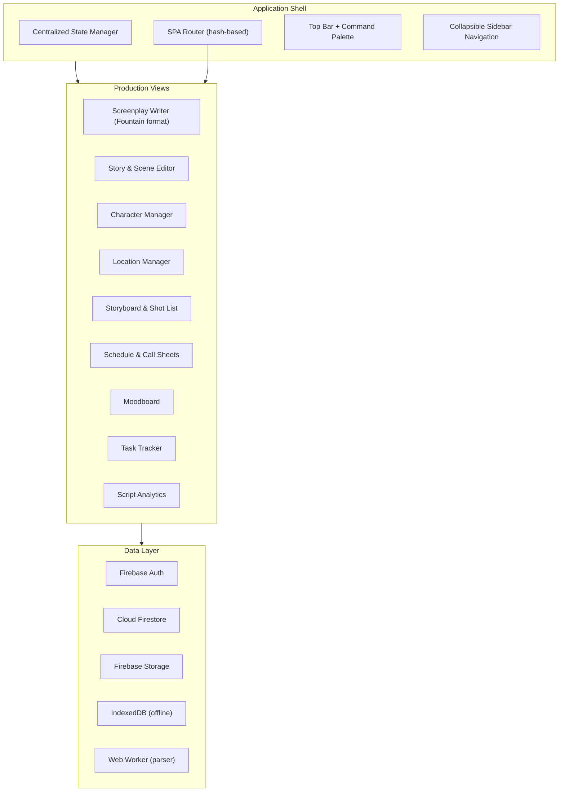

 CineCore — Filmmaking & Production Operating System


A professional, zero-dependency filmmaking operating system built entirely with **Vanilla JavaScript ES Modules**. CineCore connects screenwriting, story development, and production management into a unified workspace — from initial idea to call sheet.

## Architecture



## Features

- **Screenplay Writer** — Distraction-free Fountain-format editor with syntax highlighting, autocomplete, and export
- **Dynamic Entity Linking** — Characters, locations, props auto-link across scenes, story, and schedule
- **Scene Breakdown** — Automatically extract characters, props, and wardrobe from screenplay text
- **Storyboard & Shot Lists** — Visual shot planning with sequence management
- **Schedule & Call Sheets** — Production scheduling with day-of-shoot call sheet generation
- **Character & Location Profiles** — Detailed profiles with cross-referenced scene appearances
- **Script Analytics** — Page count, scene statistics, character dialogue distribution
- **Moodboard** — Visual reference collection for creative direction
- **Command Palette** — Quick navigation with keyboard shortcuts (Ctrl+K)
- **Multi-theme** — Midnight, light, and custom themes via CSS custom properties
- **Offline-capable** — IndexedDB for local persistence, Firebase sync when online
- **Firebase Auth** — Google sign-in with App Check security

## Project Structure

```
CineCore/
├── index.html                 # Entry point (SPA shell)
├── styles.css                 # Global styles with CSS custom properties
├── script.js                  # Bootstrap module
├── server.js                  # Simple Node.js dev server
├── js/
│   ├── app.js                 # App initialization & orchestration
│   ├── router.js              # Hash-based SPA router
│   ├── state.js               # Centralized state management
│   ├── store.js               # IndexedDB persistence layer
│   ├── entities.js            # Entity linking engine
│   ├── links.js               # Cross-reference resolver
│   ├── editor.js              # Screenplay text editor
│   ├── shortcuts.js           # Keyboard shortcut handler
│   ├── themes.js              # Theme engine
│   ├── transitions.js         # View transition animations
│   ├── pagination.js          # List pagination
│   ├── autocomplete.js        # Editor autocomplete
│   ├── components/            # UI components (topbar, sidebar, modals, toast)
│   ├── firebase/              # Firebase config, auth, firestore, storage, app-check
│   ├── views/                 # Page views (home, story, scenes, characters, etc.)
│   ├── writer/                # Screenplay writer & export engine
│   └── workers/               # Web Worker for background parsing
├── tests/                     # Test suites (UI, linking, Firebase, product engine)
├── firestore.rules            # Firestore security rules
├── storage.rules              # Storage security rules
└── .env.example               # Firebase config template
```

## Quick Start

```bash
git clone https://github.com/Deeraj1606/CineCore.git
cd CineCore
npm install
npm start          # → http://localhost:3000
```

### Firebase Setup (optional)

1. Copy `.env.example` to `.env` and fill in your Firebase config
2. The app works offline without Firebase — data persists in IndexedDB

## Tech Stack

| Layer | Technology |
|-------|-----------|
| Language | Vanilla JavaScript (ES Modules) |
| Auth | Firebase Auth (Google Sign-In) |
| Database | Cloud Firestore + IndexedDB |
| Storage | Firebase Storage |
| Security | Firebase App Check |
| Editor | Custom Fountain-format editor |
| Background Processing | Web Workers |
| Styling | CSS Custom Properties (zero frameworks) |
| Testing | Custom test suites (jsdom) |
| Font | Courier Prime (screenplay), Inter (UI) |

## License

MIT — see [LICENSE](LICENSE) for details.
